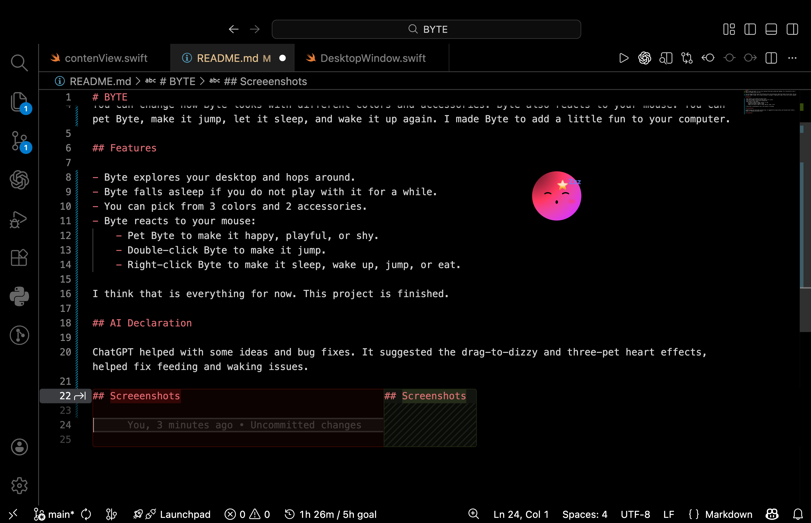
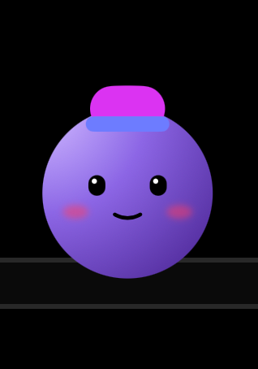

# BYTE
Byte is made with Swift. It is a tiny round pet that walks around your desktop. It is cute and fun, and it keeps you company while you work.

You can change how Byte looks with different colors and accessories. Byte also reacts to your mouse. You can pet Byte, make it jump, let it sleep, and wake it up again. I made Byte to add a little fun to your computer.

## Features

- Byte explores your desktop and hops around.
- Byte falls asleep if you do not play with it for a while.
- You can pick from 3 colors and 2 accessories.
- Byte reacts to your mouse:
    - Pet Byte to make it happy, playful, or shy.
    - Double-click Byte to make it jump.
    - Right-click Byte to make it sleep, wake up, jump, or eat.

I think that is everything for now. This project is finished.

## AI Declaration

ChatGPT helped with some ideas and bug fixes. It suggested the drag-to-dizzy and three-pet heart effects, helped fix feeding and waking issues.

## Screenshots

Thanks for reviewing my project! I hope you enjoy it.
